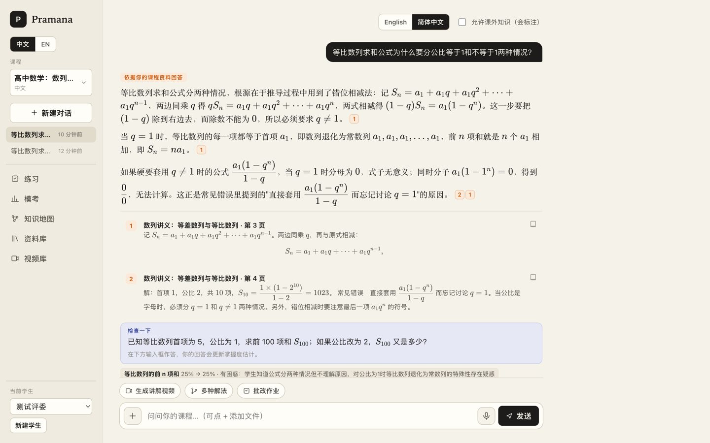

### Hi, I'm Yi Yu 👋

NYU Stern, B.S. Business and Political Economy (class of 2029).
**I turn business ideas into working AI products.** I own the idea, the product and pricing decisions and the go-to-market;
AI coding tools (Claude Code, Codex, Kimi) do the engineering. Every number below is measured and can be checked in the
linked repository or demo.

商科背景，负责想法、产品、定价与商业化落地；工程实现交给 AI 编程工具。下面的数字都是实测。

**在中国大陆访问：[yingzhilu.cn/portfolio](https://yingzhilu.cn/portfolio/)**，所有视频和演示都能直接打开。

#### 现在就能试 · Live now

| [映知录](https://yingzhilu.cn): paste a Bilibili or YouTube link, get timestamped notes ([a real note](https://yingzhilu.cn/s/cFQ9Ak69fOD1WyqDgdtKbxkPv-_fT7eC)) | [Pramana](https://pramana.yingzhilu.cn): answers only from your course, every sentence cited (invite code `yiyu-kimi-1024`) |
|---|---|
|  |  |

Both run on Kimi K2.6 by default.

#### Products

| Project | What it does | Evidence |
|---|---|---|
| [**映知录 Yingzhilu**](https://github.com/yy5652-hash/yingzhilu) · [**try it**](https://yingzhilu.cn) | One link in, one video understood: chapters, a timestamped summary and questions answered from the video itself, for viewers in mainland China. | Kimi K2.6 by default, with Zhipu GLM and DeepSeek as backups; per-month cost and usage caps; ICP-filed; web app plus WeChat mini-program, iOS and Android clients |
| [**Pramana**](https://github.com/yy5652-hash/pramana) · [**try it**](https://pramana.yingzhilu.cn) · [film](https://youtu.be/63be_42pV3k) / [国内](https://yingzhilu.cn/portfolio/#pramana) | A study companion that answers only from your course (textbook, slides, lecture videos) and cites the page, the slide or the second it came from. The new version runs in Chinese and English on Kimi, with practice, mock exams and a knowledge map. | RAGAS faithfulness 0.96, context recall 1.00; 14 of 14 off-course questions declined |

#### Agents

| Project | What it does | Evidence |
|---|---|---|
| [**Relay Home**](https://github.com/yy5652-hash/relay-home) · [film](https://youtu.be/EhCnOVfZsgE) / [国内](https://yingzhilu.cn/portfolio/#relay-home) | An Alexa+ household agent that replans an evening and asks before it acts; the helper answers from their own phone. | Self-hosted MCP server (Streamable HTTP), MCP Apps, an Agent Skill, voice in and out; [PR to the MCP TypeScript SDK](https://github.com/modelcontextprotocol/typescript-sdk/pull/2999) |
| [**Nightwatch Foundry**](https://github.com/yy5652-hash/nightwatch-foundry) | A "dark factory" of four coding agents: one human message in, a working service out. | 4 of 4 stages accepted by an independent verifier agent in 10 h 39 min; 381 commits |
| [**House Programme**](https://github.com/yy5652-hash/house-programme) · [live demo](https://house-programme.onrender.com/?example=lisbon) · [film](https://yingzhilu.cn/portfolio/#house-programme) | An event planner for small venues: an agent asks Qloo's taste graph what the regulars love and builds a month of events with the evidence for every pick. | About 20 s per live build |
| [**GreenLane**](https://gitlab.com/gitlab-ai-hackathon/transcend-october-2026/43061395/showcase) · [live board](https://greenlane.yingzhilu.cn/lane) · [film](https://yingzhilu.cn/portfolio/#greenlane) | An AI release lane for GitLab: runs only the CI jobs a change needs, and a GitLab Duo agent repairs failed pipelines. | A docs change runs 2 of 11 jobs (−75 % CO2e); a failed pipeline fixed in 111 s with nobody asking |

#### Evaluation and safety

| Project | What it does | Evidence |
|---|---|---|
| [**Dutch Book Bench**](https://dev.to/yy5652hash/i-tried-to-dutch-book-13-llm-forecasters-asked-one-question-at-a-time-every-one-of-them-paid-out-1flm) · [Kaggle benchmark](https://www.kaggle.com/benchmarks/yy5652/dutch-book-bench) | Can a bookie lock in a risk-free profit against an LLM forecaster's probabilities? | 26 models: 95–100 % coherent when asked a whole question family at once, 49–89 % when asked one statement per call |
| **AlpineProbe** (code public from 1 Dec 2026) | A reproducible red-teaming harness for the Swiss open model Apertus 70B (Hack Apertus 2026). | 7,532 prompts on the official checkpoint; every finding comes with a tested mitigation |

#### AI for science

| Project | What it does | Evidence |
|---|---|---|
| [**ChipQC Guardian**](https://github.com/yy5652-hash/chipqc-guardian-ai4s) · [in-browser demo](https://yy5652-hash.github.io/chipqc-guardian-ai4s/) | An auditable quality gate for organ-on-a-chip microscopy: pass, re-acquire or review, with an exact evidence map. | AUROC 0.880 on imaging days the model never saw |
| [**ChipQC RAG on ROCm**](https://github.com/yy5652-hash/chipqc-guardian-amd-league) | Offline, citation-exact question answering over mixed enterprise documents, for the AMD AI League. | Qwen3-VL-8B + Qwen3-Embedding in one container, no network at evaluation |
